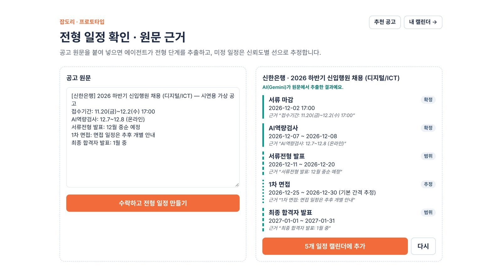
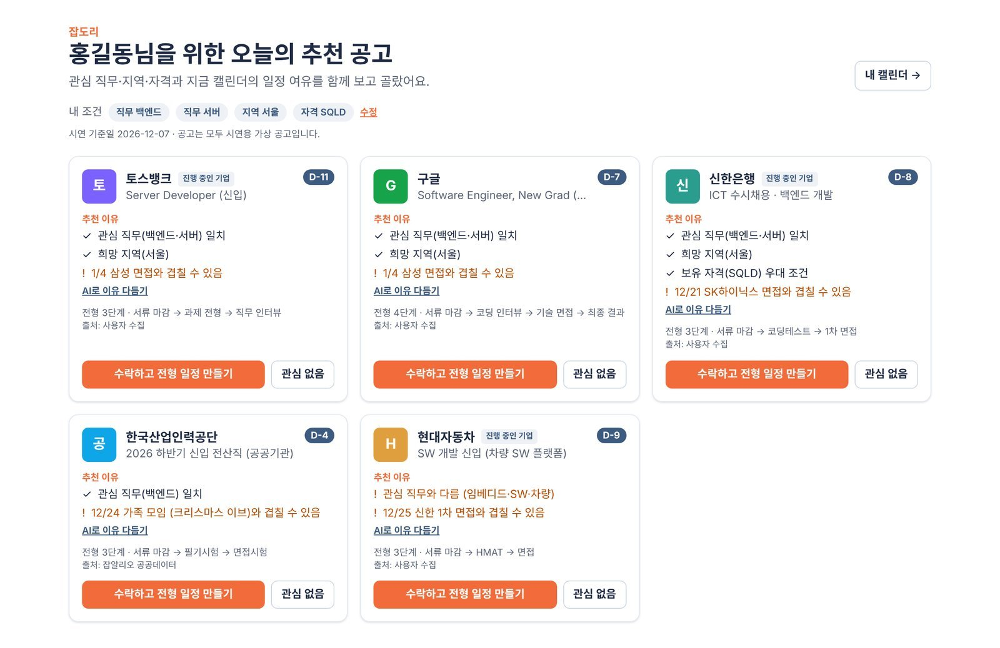
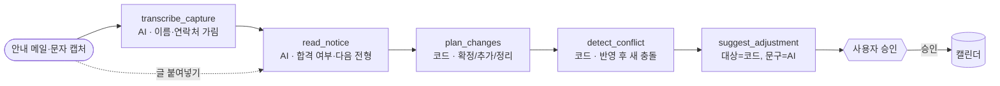
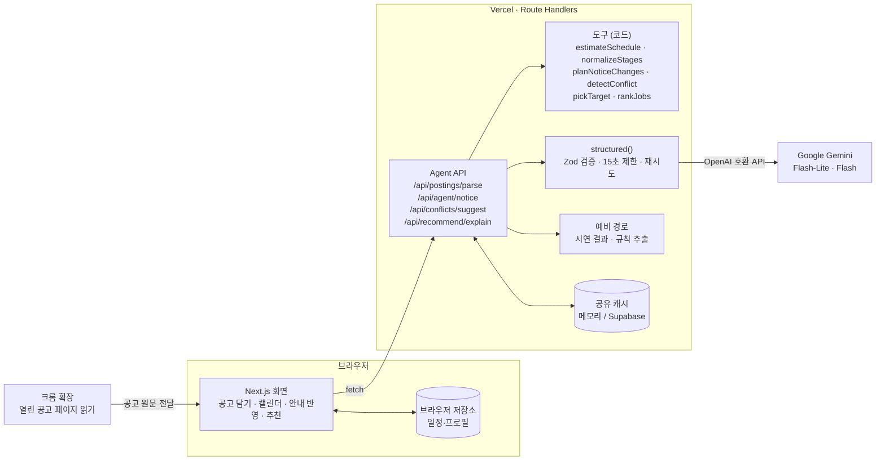

# 잡도리 — 취준 일정, 단단히 챙기다

> **Job + 도리** · 2026 대한민국 청년 CAREER FAIR AI 해커톤 출품작 · 팀 싸피

공고를 수락하면 **AI 에이전트**가 서류 마감부터 최종 발표까지 전형 일정을 캘린더에 만들어 줍니다.
결과 안내 메일이나 문자 캡처를 넘기면 다음 전형을 확정하고, 면접·자격증 시험·알바·약속이 겹치기 전에 알려 줍니다.

| 바로 해보기 | 소개서 | AI 활용내역 | 개발 설명 | 시연 영상 |
|---|---|---|---|---|
| **[kcci-beta.vercel.app](https://kcci-beta.vercel.app)** (로그인 없음) | [`docs/proposal.pdf`](docs/proposal.pdf) | [`docs/ai-usage.txt`](docs/ai-usage.txt) | [아래 개발 설명](#개발-설명) | _업로드 후 링크_ |


---

## 왜 만들었나

취준생은 보통 5~10곳에 동시에 지원합니다. 지원할 때마다 서류 마감, AI 역량검사, 코딩테스트, 필기, 1·2차 면접, 발표일이 생기는데, 이 일정은 공고문·메일·문자에 흩어져 있고 대부분 **"추후 안내"** 입니다.
그래서 면접이 친구 약속이나 자격증 시험과 겹친 걸 전날에야 알게 됩니다.

잡도리는 이 일을 에이전트에게 맡깁니다.
- **공고를 읽어** 전형 단계를 캘린더에 올립니다. 날짜가 없는 단계는 앞 단계 기준으로 추정해 둡니다.
- **안내를 읽어** 추정 일정을 확정으로 바꾸고, 바뀐 일정이 다른 일정과 겹치는지 바로 확인합니다.
- **확실함의 정도를 선으로** 보여 줍니다. 확정은 실선과 시각, 범위는 점선, 규칙 추정은 점점선과 "시간 미정"입니다.

---

## 3분 시연 순서

처음 열면 시연 인물 **홍길동**의 12월 일정이 들어 있습니다. 지원 5곳(토스뱅크·현대자동차·삼성전자·SK하이닉스·LG CNS) 전형, 정보처리기사·ADsP, 카페 알바·스터디·가족 모임·고등학교 친구 술약속·동아리 송년회가 있고, 기준일은 2026-12-07입니다.

| # | 화면 | 해볼 것 | 보이는 것 |
|---|---|---|---|
| 1 | **공고 담기** (첫 화면) | 들어 있는 신한은행 공고로 '수락하고 전형 일정 만들기' | Gemini가 뽑은 전형 5단계, 단계마다 원문 근거와 확정/범위/추정 |
| 2 | **내 캘린더** | '캘린더에 추가' | 신한 1차 면접(추정)이 알바·송년회와 겹칠 수 있다는 경고 |
| 3 | **안내 반영** | 예시 '토스뱅크 서류 합격' → '에이전트에게 맡기기' | 실행 기록, 12/18 18:00 면접 확정 시 19:00 술약속과 충돌, 약속 옮기기 메시지 |
| 4 | **안내 반영** | 예시 '캡처: SK하이닉스 면접 문자' → '에이전트에게 맡기기' | 캡처에서 글자를 옮기며 이름·연락처 가림, 12/22 10:00 확정 제안 |
| 5 | **내 캘린더** | 확인 후 '캘린더로 내보내기' | 점선이 실선과 시각으로 바뀜, `.ics` 파일로 Google·iPhone 캘린더에 가져오기 |
| 6 | **추천 공고** | 둘러보기 | 관심 직무·지역·자격과 캘린더 여유로 추천, 내 일정과 겹칠 공고는 미리 경고 |

다시 처음부터 하려면 캘린더의 **'시연 처음 상태로'** 를 누르면 됩니다.

<table>
<tr>
<td width="50%"><br><sub>① 공고 → 전형 단계·원문 근거·확정/범위/추정</sub></td>
<td width="50%"><br><sub>⑥ 맞춤 공고 추천과 일정 겹침 경고</sub></td>
</tr>
<tr>
<td><br><sub>③ 안내 반영 에이전트: 도구 실행 기록 → 충돌 → 조정 메시지 → 승인</sub></td>
<td><br><sub>④ 문자 캡처 판독: 이름·연락처 가림 → 면접 확정 제안</sub></td>
</tr>
</table>

---

## 에이전트 구조

안내 하나를 받으면 에이전트가 도구를 차례로 호출하고, 단계마다 **누가(AI·코드·예비) 했는지와 걸린 시간**을 화면에 남깁니다. 캘린더에 반영하는 건 마지막에 사용자가 승인할 때뿐입니다.



| 도구 | 담당 | 하는 일 |
|---|---|---|
| `parse_posting` | AI | 공고 원문 → 전형 단계, 날짜 종류(확정·범위·미정), 원문 근거 문장 |
| `estimate_schedule` | 코드 | 날짜가 없는 단계를 앞 단계 + 기본 간격으로 추정 (점점선) |
| `transcribe_capture` | AI | 캡처 이미지 → 안내 글 (이름은 [이름], 연락처는 [연락처]로 가림) |
| `read_notice` | AI | 안내 → 합격·불합격·일정 안내, 다음 전형 날짜·시각·방식 |
| `plan_changes` · `detect_conflict` | 코드 | 캘린더 변경안, 반영했을 때 새로 생기는 충돌 |
| `suggest_adjustment` | 코드 + AI | 옮길 일정은 코드 규칙으로 고르고, 채용담당자 문의 문구는 AI가 씀 (개인 약속은 기본 문구) |
| `rank_jobs` | 코드 + AI | 추천 점수는 규칙, 추천 이유 문장만 AI |

**AI는 읽고 쓰기만 하고, 판단은 코드가 하며, 확정은 사용자가 합니다.** 충돌 여부, 조정 대상, 추천 점수는 항상 코드로 정합니다.

### 결과를 믿을 수 있게
- **원문 근거**: 모든 날짜에 근거 문장을 붙입니다. 근거가 원문에 없으면 '근거 확인 필요'로 표시합니다.
- **신뢰도 표시**: 실선(확정), 점선(범위), 점점선(규칙 추정). 추정 일정은 "시간 미정"으로 표시하고, `.ics` 내보내기에도 [범위]/[추정]과 TENTATIVE를 붙입니다.
- **개인정보**: AI에 보내기 전에 이름·이메일·전화번호를 가립니다. 안내 원문과 캡처 이미지는 저장하지 않습니다.
- **AI가 안 될 때**: 키가 없거나, 무료 한도에 걸리거나, 응답이 15초를 넘기면 시연용 공고·안내는 미리 분석한 결과로, 그 밖의 입력은 규칙 추출로 처리합니다. 이때 화면에 '규칙 기반 예비 결과'라고 표시합니다.
- **비용**: 같은 공고는 원문 해시로 한 번만 분석합니다(공유 캐시). IP당 분당 12회로 요청을 제한합니다. 민간 플랫폼은 크롤링하지 않고, 사용자가 연 페이지만 크롬 확장으로 읽습니다.

---

## 기술 스택

| 영역 | 사용 |
|---|---|
| 웹 | Next.js 16 (App Router), React 19, TypeScript, Tailwind CSS v4 |
| AI | Google Gemini API (OpenAI 호환 엔드포인트) — `gemini-3.5-flash-lite`(추출·판독), `gemini-3.8-flash`(문장 생성, 혼잡하면 Flash-Lite로 대체) |
| 구조화 출력 | OpenAI SDK `chat.completions.parse` + Zod 스키마 검증 (공급자는 `LLM_BASE_URL`로 교체: Gemini·Groq·OpenAI) |
| 저장 | 브라우저 저장소 (MVP). Supabase 스키마·RLS·서버 API는 구현해 둠 |
| 확장 | Chrome Extension MV3 (빌드 없는 JS) |
| 테스트·배포 | Vitest, Playwright (E2E·영상), Vercel |


---

## 개발 설명

### 전체 구조



- 화면과 API를 Next.js 앱 하나에 두고 Vercel에 배포합니다. 로그인 없이 바로 써 볼 수 있도록 MVP는 일정을 브라우저 저장소에 둡니다.
- AI 호출은 `src/lib/agent/llm.ts`의 `structured()` 한 곳으로만 합니다. 공급자와 모델은 환경변수(`LLM_BASE_URL`, `LLM_MODEL_*`)로 바꿉니다.
- AI가 답하지 못하면(키 없음, 한도, 15초 초과) 같은 API가 예비 경로로 응답하고, 응답에 `mode`(ai · cache · demo · rule)를 붙여 화면에 출처를 표시합니다.

### 요청 흐름

**공고 → 전형 일정** (`POST /api/postings/parse`)
1. 원문을 정규화한 뒤 sha256을 구해 공유 캐시를 찾습니다. 있으면 AI를 다시 부르지 않습니다.
2. `parsePosting`: Gemini가 `PostingExtraction`(회사, 공고명, 단계별 유형·날짜 종류·시작/끝·시각·근거 문장)을 구조화 출력으로 돌려줍니다.
3. `normalizeStages`(코드): 서비스 규칙을 적용합니다. 접수 기간은 마감일 하루로, 'N월 중'은 그 달 전체로, 날짜가 둘 다 적힌 기간은 확정으로 정리합니다.
4. `estimateSchedule`(코드): 날짜가 없는 단계를 앞 단계 날짜와 기본 간격(`DEFAULT_GAP`)으로 추정하고 신뢰도(high · mid · low)를 붙입니다. 근거가 원문에 없으면 `evidence_missing`으로 표시합니다.
5. 사용자가 화면에서 확인하고 '캘린더에 추가'를 누를 때만 저장합니다.

**안내 → 캘린더 반영** (`POST /api/agent/notice`)

| 순서 | 도구 | 담당 | 출력 |
|---|---|---|---|
| 1 | `transcribe_capture` | AI (이미지) | 캡처 속 안내 글, 이름·연락처는 가림 → `maskPII`로 한 번 더 |
| 2 | `read_notice` | AI | 합격·불합격·일정 안내, 다음 전형 유형·날짜·시각·방식, 근거 |
| 3 | `plan_changes` | 코드 | 확정(점선→실선) · 추가 · 이후 일정 정리 변경안 |
| 4 | `detect_conflict` | 코드 | 변경안을 적용해 보았을 때 새로 생기는 충돌 |
| 5 | `suggest_adjustment` | 코드 + AI | 옮길 일정 선정(코드), 채용담당자 문의 문구(AI) 또는 약속 조정 기본 문구 |
| 6 | `await_approval` | 사용자 | 승인하면 브라우저 저장소에 반영 |

단계마다 담당·소요 시간·요약을 `trace`로 돌려주고, 화면의 '에이전트 실행 기록'에 그대로 보여 줍니다.

### 코드 구조

| 위치 | 역할 |
|---|---|
| `web/src/lib/agent/llm.ts` | `structured()` — 구조화 출력(`chat.completions.parse` + Zod), 미지원 공급자는 JSON 모드로 대체, 이미지 입력, 웹 요청 시간 제한, REASON 모델 혼잡 시 Flash-Lite로 대체 |
| `parsePosting.ts` · `normalizeStages.ts` · `estimateSchedule.ts` | 공고 추출 → 규칙 정리 → 미정 일정 추정 |
| `readNotice.ts` · `transcribeCapture.ts` · `pii.ts` · `evidence.ts` | 안내·캡처 판독, 개인정보 가림, 근거 확인 |
| `noticeAgent.ts` | 안내 반영 에이전트 (도구 순차 호출 + 실행 기록) |
| `detectConflict.ts` · `conflictAdvice.ts` · `suggestAdjustment.ts` | 충돌 판단(하루를 쓰는 일정만), 조정 대상 선정, 조정 문구 |
| `fallback.ts` · `cache.ts` | AI 예비 경로(시연 결과·규칙 추출·규칙 판독), 공유 캐시 |
| `web/src/lib/calendar.ts` · `notice.ts` · `recommend.ts` · `ics.ts` | 캘린더 모델·칩 표시, 변경안 계산, 추천 점수, `.ics` 내보내기 |
| `web/src/lib/store.ts` | 브라우저 저장소 (`useSyncExternalStore`), 첫 방문 시 시연 데이터 |
| `web/src/lib/remote.ts` · `supabase/migrations/` | Supabase 행 ↔ 캘린더 변환, 스키마 + RLS (로그인 연동용) |
| `web/src/app/` | 화면: `/` 공고 담기 · `/calendar` · `/notices` 안내 반영 · `/recommend` · `/import`(확장 연결) |
| `extension/` | 크롬 확장 MV3 — 현재 탭 텍스트 → 분석 → 웹 캘린더에서 확인 후 담기 |
| `eval/` · `web/scripts/` | 가상 평가셋(공고 40 · 메일 20 · 충돌 10)과 측정·생성 스크립트 |

### API

| 메서드·경로 | 입력 | 출력 | AI |
|---|---|---|---|
| `POST /api/postings/parse` | 공고 원문, 기준일, 출처 URL | 추출 결과, 신뢰도 붙은 일정, `mode` | 추출 |
| `POST /api/agent/notice` | 안내 글 또는 캡처 이미지(data URL), 현재 일정 | 실행 기록, 판독, 변경안, 새 충돌과 조정 문구 | 캡처·판독·문구 |
| `POST /api/notices/read` | 안내 글 | 판독 결과 (단독 호출용) | 판독 |
| `POST /api/conflicts` · `/suggest` | 일정 목록 / 충돌 1건 | 충돌 목록 / 조정 대상·이유·문구 | 문구만 |
| `POST /api/recommend/explain` | 공고, 프로필, 규칙 근거 | 추천 이유 문장 | 문장만 |
| `POST /api/applications` · `GET /api/calendar` | 사용자 토큰 | Supabase 저장·조회 (키 없으면 501) | — |

### 데이터 모델

- **CalendarItem**: `id`, `groupId`(지원 건), `label`, `company`, `category`(지원·개인·자격증), `start`/`end`, `time`, `confidence`, `evidence`, `status`(예정·확정·완료·정리)
- **신뢰도와 선 스타일**: high = 실선·시각 표시, mid = 점선(범위), low = 점점선(규칙 추정)·"시간 미정"
- **Supabase**: `posting_cache`(원문 해시 → 추출 결과), `applications`, `stages`(근거 문장만 저장), `personal_events`, `notice_logs`(원문 없이 결과·근거만). 모든 사용자 테이블에 본인만 읽고 쓰는 RLS 정책이 걸려 있습니다.

### 설계 원칙
- **AI는 제안, 사용자가 확정**: 일정 추가·확정·삭제는 모두 사용자 승인 뒤에 반영합니다.
- **판단은 코드**: 충돌 여부, 조정 대상, 추천 점수, 미정 일정 추정은 코드가 정하고 테스트합니다. AI는 형식이 제각각인 글을 읽고 문장을 쓰는 일만 합니다.
- **구조화 출력**: LLM 출력은 Zod 스키마로 받습니다. strict 모드 호환을 위해 선택 값은 `optional` 대신 `nullable`로 둡니다.
- **근거와 개인정보**: 날짜마다 원문 근거를 저장하고, AI에 보내기 전 개인정보를 가리며, 안내 원문과 이미지는 저장하지 않습니다.
- **비용과 장애**: 공유 캐시로 같은 공고는 한 번만 분석하고, IP당 분당 12회로 요청을 제한합니다. AI가 실패하면 예비 경로로 응답해 화면이 멈추지 않습니다.
- **크롤링 금지**: 민간 채용 플랫폼은 긁어오지 않고, 사용자가 연 페이지만 확장으로 읽습니다.

### 테스트

```bash
cd web
npm test                   # Vitest 55개: 추정·정리 규칙, 충돌 시나리오 10건, 에이전트, 예비 경로, .ics, 캐시 해시
npm run lint && npm run build
npm run eval -- postings   # 정형 공고 30건 (키 필요)
npm run eval -- hard       # 비정형 공고 10건
npm run eval -- rule       # 같은 공고를 규칙 추출만으로 (비교 기준)
npm run eval -- notices    # 안내 메일 20건
```
화면 흐름은 Playwright로 키 없음 / 잘못된 키 / 정상 키 세 가지 조건에서 처음부터 끝까지 확인했습니다.

### 한계와 다음 단계
- 로그인을 붙여 브라우저 저장소 대신 Supabase로 동기화 (서버 API와 스키마는 구현됨)
- 잡알리오 공공기관 채용정보·Q-net 시험 일정 API 연동 (현재 시연은 가상 데이터)
- 충돌을 날짜 단위가 아니라 시각·이동 시간 단위로 판단
- 실제 공고와 사용자 수정 내역으로 평가셋을 늘려 정확도를 계속 측정

---

## 로컬 실행

```bash
cd web
cp .env.example .env.local   # 아래 값 입력
npm install
npm run dev                  # http://localhost:3000
```

```dotenv
LLM_BASE_URL=https://generativelanguage.googleapis.com/v1beta/openai/
LLM_API_KEY=                 # aistudio.google.com 무료 키
LLM_MODEL_EXTRACT=gemini-3.5-flash-lite
LLM_MODEL_REASON=gemini-3.8-flash
```

키가 없어도 모든 화면이 동작합니다. 이때는 시연 데이터, 미리 분석한 결과, 규칙 추출, 기본 문구로 처리합니다.
배포 방법은 [`docs/deploy.md`](docs/deploy.md)에 있습니다 (Vercel Root Directory는 `web`).

**크롬 확장**: `chrome://extensions` → 개발자 모드 → '압축해제된 확장 프로그램 로드' → `extension/` 폴더 선택. 팝업의 '설정'에서 웹 주소를 바꿀 수 있습니다.
